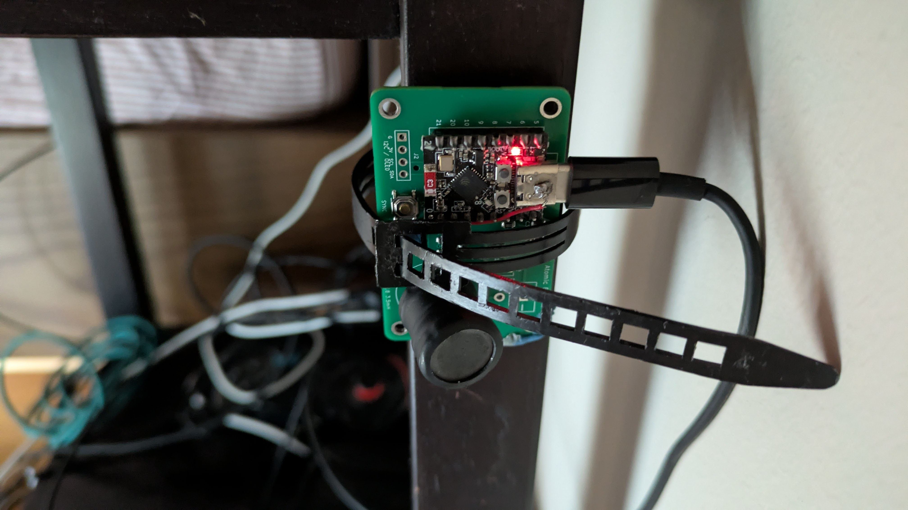
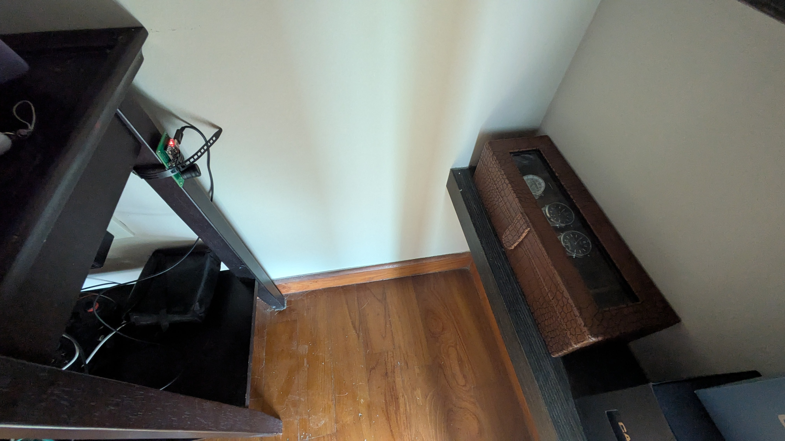
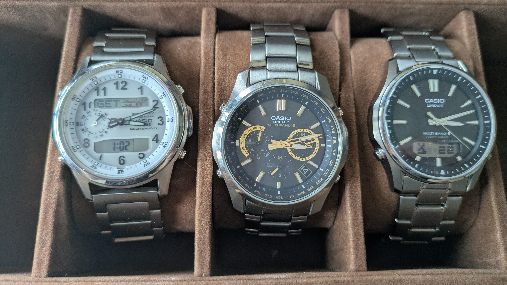

# MultiBand6-ESP32-AtomicBeacon: Hardware Atomic Clock Simulator

An open-hardware, low-power near-field radio transmitter built on the **ESP32-C3-Mini** with custom PCB designs, resonant magnetic antenna, 3D enclosure, and embedded web UI. Simulates authentic LF radio time signal broadcasts (**BPC, WWVB, MSF, DCF77, JJY40, JJY60**) to synchronize radio-controlled ("atomic") wristwatches and clocks over a localized range (~0.3 m to 1.0 m).

### 🏠 Real-World Setup & Confirmed Working
> **Built and actively in daily operation in Singapore!**  
> Since Singapore receives no LF signals from any of the official time towers, this device was built to solve that problem. It runs quietly every night on a bedroom nightstand, placed approximately **30 cm from a watch box**, successfully synchronizing a multi-watch collection every single night.
> 
> *(Compatible with all radio-controlled timepieces including **Casio G-Shock / Oceanus / Wave Ceptor / Lineage**, **Citizen Eco-Drive**, **Seiko**, **Timex**, **Junghans**, and standalone atomic desk clocks).*

| Assembled Hardware & Antenna | Bedroom Watch Box Deployment | 3 MultiBand 6 Watches Synced |
| :---: | :---: | :---: |
|  |  |  |
| *Custom 2-layer PCB with ESP32-C3 SuperMini & magnetic inductor antenna.* | *Operational placement ~30 cm from the watch box on the nightstand.* | *Simultaneous sync proof: Casio Wave Ceptor (`GET 1:02`), Lineage Chronograph, and Lineage Ana-Digi.* |

> [!IMPORTANT]
> **Wi-Fi & Network Time Requirement:**  
> The beacon does not contain a battery-backed hardware RTC chip. On boot and prior to each broadcast, it connects to your home 2.4 GHz Wi-Fi to fetch sub-second reference time from public NTP atomic clock servers (`pool.ntp.org`).  
> 
> **Placement Tip:** Place the beacon in a location with steady Wi-Fi reception (e.g. bedside or near your watch box where home Wi-Fi reaches). If placed in a Wi-Fi-dark dead zone on cold boot, the device cannot obtain the initial atomic epoch, and watch broadcasts/sync buttons will remain locked until time synchronization completes.

> [!TIP]
> 🚀 **Just want to get your watch syncing tonight?**  
> Check out the **[5-Minute Quick Start Guide](QUICKSTART.md)** for 1-click in-browser web flashing — zero software installation or coding required! For watch brand setup notes, see the **[Watch Compatibility Guide](CASIO_GUIDE.md)**.

---

## 1. Bill of Materials (BOM) & Components

| Component | Value / Specification | Role in Circuit | Rationale / Notes |
| :--- | :--- | :--- | :--- |
| **Microcontroller** | **ESP32-C3-Mini** | Core Controller & Carrier Generator | Single-core 32-bit RISC-V (160 MHz), hardware LEDC PWM with fractional clock divider, RTC timer, Wi-Fi 4, BLE 5. |
| **NPN Transistor** | **C1815 (2SC1815)** | Power Switch / RF Driver (Option A) | Small-signal NPN transistor (TO-92 package, E-C-B pinout) switching the LC tank at 5V for extended 1.0 m+ range. *(Note: You could also use a 2p2222 / 2N2222, but that transistor's different E-B-C pinout must be respected!)* |
| **Base Resistor ($R_{base}$)** | **$1\text{ k}\Omega$ (1/4 W)** | Transistor Base Drive (Option A) | Connects between GPIO 1 and C1815 Base (Pin 3). Limits base drive current to a safe $\sim 2.6\text{ mA}$ for saturation switching. |
| **Inductor ($L$)** | **16×18 3.5mH I-Type Inductor** | Magnetic Antenna ($H$-field radiator) | The reference hardware build specifically uses a **16×18 mm 3.5 mH I-type** (radial drum/bobbin core) power inductor. Its open magnetic circuit allows magnetic dipole flux lines to radiate into the room with low DC resistance. |
| **Tuning Capacitor ($C$)** | **1.5 nF (1500 pF / code `152`)** | Parallel LC Tank Resonator | Metallized Film (CBB / Polypropylene / Polyester) or C0G/NP0 ceramic. Rated $\ge 50\text{V}$. |
| **Damping Resistor ($R_{damp}$)** | **$220\,\Omega$ (1/4 W)** | Bandwidth Broadening & Safety Current Limiter | Lowers tank $Q$ to $\sim 6.5$, broadening bandwidth to $\sim 10\text{ kHz}$. Limits peak current to $\approx 23\text{ mA}$ in transistor booster or $\approx 15\text{ mA}$ in direct GPIO drive. |
| **DC Blocking Cap ($C_{block}$)** | **$1\,\mu\text{F}$ (or $100\text{ nF}$)** | DC Isolation & GPIO Protection (Option B) | Only required if running Option B (Direct GPIO Drive without transistor). Completely blocks DC current so pin cannot burn out if stuck `HIGH`. |

---

## 2. Hardware Circuit Schematics & Pinout

### Default Pin Assignment & ESP32-C3 SuperMini Pinout

The firmware defaults to **GPIO 1** for the antenna carrier output (`#define ANTENNA_PIN 1` in `src/main.cpp`).

| Board Pin | ESP32-C3 Signal | Role | Circuit Connection |
| :--- | :--- | :--- | :--- |
| **GPIO 1** | `IO1` (LEDC Ch 0) | **Default RF Carrier Out** | Connects to base resistor ($1\text{ k}\Omega$) driving booster NPN transistor, or direct antenna |
| **GPIO 2** | `IO2` | *(Unconnected)* | Strapping pin on ESP32-C3; reserved to prevent USB flashing and cold-boot issues |
| **GPIO 3** | `IO3` (Active LOW) | **Manual Sync Pushbutton** | Connects to tactile button `SW1` / external header `J3` with 10 kΩ pull-up |
| **GPIO 4** | `IO4` (I2C SDA) | **I2C Expansion (OLED)** | Connects to `J2` Pin 4 with 4.7 kΩ pull-up for 0.96" SSD1306 OLED display |
| **GPIO 5** | `IO5` (I2C SCL) | **I2C Expansion (OLED)** | Connects to `J2` Pin 3 with 4.7 kΩ pull-up for 0.96" SSD1306 OLED display |
| **GPIO 8** | `IO8` (Active LOW) | **Onboard Status LED** | Breathing nightstand pulse during active broadcast; 100% dark in standby |
| **5V / VIN** | `VBUS` (USB 5V) | Primary Power Rail | Supplies the booster circuit & damping resistor |
| **GND** | `GND` | Common Ground Return | Connects to transistor Emitter, capacitor ground, and ground plane |

> [!TIP]
> **Custom PCBs Available:**
> - **SMT Carrier Board (58×36 mm):** Located in [`pcb/smd/`](pcb/smd/) (or symlink [`smd/`](smd/)), uses 100% JLCPCB Basic Components ($0 setup fees) for fast turnkey assembly.
> - **Through-Hole DIY Edition (70×46 mm):** Located in [`pcb/hole-through/`](pcb/hole-through/) (or symlink [`hole-through/`](hole-through/)), 100% hand-solderable with standard through-hole passives, TO-92 transistor, DO-41 diode, and M3 mounting holes. Zero SMD parts required. See [`hole-through/README.md`](hole-through/README.md) for BOM and build guide.

> **Why GPIO 1?**
> * **Boot & Flashing Safety:** On the ESP32-C3, GPIO 2, 8, and 9 are hardware strapping pins. Pulling GPIO 2 low (which occurs when driving an NPN transistor base to ground) prevents entering Download Boot mode over USB and causes boot lockups. **GPIO 1 is a pure GPIO/ADC with zero strapping functions**, allowing reliable cold boots and in-circuit flashing over USB.
> * **LEDC Peripheral:** Native hardware routing to LEDC channel 0 with fractional divider clocking.
> * **Physical Placement:** Located on the accessible edge header directly adjacent to Pin 6 on the **ESP32-C3 SuperMini** (Pin 7).

```
      TOP VIEW (Component Side — looking at chip & buttons)
                       ┌───[ USB-C ]───┐
     [BOOT Button Side]│               │[RST Button Side]
              GPIO 5   │ [ ]       [ ] │   5V          <── Top-Right (next to USB)
              GPIO 6   │ [ ]       [ ] │   GND (G)     <── Next to 5V
              GPIO 7   │ [ ]       [ ] │   3V3 (3.3)   <── Regulated 3.3V
              GPIO 8   │ [ ]       [ ] │   GPIO 4
              GPIO 9   │ [ ]       [ ] │   GPIO 3
             GPIO 10   │ [ ]       [ ] │   GPIO 2
             GPIO 20   │ [ ]       [■] │   GPIO 1      <── [■] ANTENNA OUT (Pin 7)
   (Pin 21)  GPIO 21   │ [ ]       [ ] │   GPIO 0      (Pin 0)
                       └──[ Antenna ]──┘

      BOTTOM VIEW (Underside — looking at PCB silkscreen labels)
                       ┌───[ USB-C ]───┐
                       │               │
     Top-Left (5V) ──► │ [ ]       [ ] │   GPIO 5
              GND (G)  │ [ ]       [ ] │   GPIO 6
            3V3 (3.3)  │ [ ]       [ ] │   GPIO 7
               GPIO 4  │ [ ]       [ ] │   GPIO 8
               GPIO 3  │ [ ]       [ ] │   GPIO 9
               GPIO 2  │ [ ]       [ ] │   GPIO 10
   ANTENNA OUT ──────► │ [■]       [ ] │   GPIO 20
     (Pin 0)   GPIO 0  │ [ ]       [ ] │   GPIO 21     (Pin 21)
                       └───────────────┘
```

---

### Option A: C1815 NPN Transistor Booster Circuit (Recommended for 1.0 m+ Range)

This configuration uses the **C1815 (2SC1815) NPN** transistor powered directly from the **5V USB rail**. It isolates the ESP32 silicon and delivers $3\times$ to $5\times$ more magnetic flux for extended range:

```
                                  +5V (from ESP32 5V / VIN Pin)
                                    │
                                    ├───[ 220 ohm ]─── (R_damp)
                                    │
                                    ├───┬───────────────┬───┐
                                     │   │               │   │
                                     │  [16x18 3.5mH] [ 1.5 nF ]  (Parallel LC Tank)
                                     │  (I-type Ind.) (Capacitor)
                                     │   │               │   │
                                     └───┴───────────────┴───┘
                                                 │
                                                 ▼
                                          [ C ] Collector (Pin 2)
   ESP32-C3 GPIO 1 ──[ 1k ohm ]────────── [ B ] Base (Pin 3)       C1815 NPN Transistor
   (Default PWM Out) (R_base)             [ E ] Emitter (Pin 1)
                                                 │
                                                 ▼
   ESP32-C3 GND ─────────────────────────────────┴─── Common Ground (GND)
```

#### Why This Works Well:
1. **Zero Stress on ESP32:** The GPIO 1 pin only sources a safe $I_B \approx 2.6\text{ mA}$ into the base through the $1\text{ k}\Omega$ base resistor ($V_{GPIO} = 3.3\text{V}$, $V_{BE} \approx 0.7\text{V}$).
2. **5V Swing:** The LC tank swings around the 5V rail rather than 3.3V, pushing significantly more magnetic current through the 3.5 mH inductor.
3. **Uses Your $220\,\Omega$ Resistor:** The $220\,\Omega$ damping resistor limits peak collector current to a cool, safe $\approx 23\text{ mA}$ while maintaining the broad $\sim 10.7\text{ kHz}$ bandwidth so 68.5 kHz BPC resonates smoothly.
4. **Broadcast Range:** Up to **1.0 m – 1.2 m**.

#### C1815 Transistor Pinout & Pinout Connections (TO-92 Package)

The circuit is designed specifically around the **C1815 (2SC1815)** small-signal NPN transistor.

Looking at the **flat printed face** (labeled "C1815") with the leads pointing downwards, the pinout follows the standard Asian / JIS **E-C-B** configuration:

```
          TO-92 Package (Front View)
               ┌───────────┐
               │   C1815   │   <── Flat Printed Face
               │   GR 331  │
               └─┬───┬───┬─┘
                 │   │   │
                 1   2   3
                 E   C   B
```

| Pin # | Lead Name | Circuit Function | Breadboard Connection |
| :---: | :--- | :--- | :--- |
| **Pin 1 (Left)** | **Emitter (E)** | Common Ground Return | Connects directly to **(-) Blue GND Rail** (Row 13) |
| **Pin 2 (Center)** | **Collector (C)** | Switched LC Tank Low Side | Connects to **Row 12** (bottom of 3.5 mH inductor & 1.5 nF cap) |
| **Pin 3 (Right)** | **Base (B)** | RF Carrier PWM Input | Connects to **Row 11** (receives drive from GPIO 1 via $1\text{ k}\Omega$ resistor) |

> [!NOTE]
> **Orientation Tip:** Because **Base is Pin 3 (Right)** on the C1815, mounting the transistor with its flat face facing right puts Pin 3 (Base) at **Row 11**, directly adjacent to ESP32 GPIO 1 (Row 7). This allows the $1\text{ k}\Omega$ base resistor to bridge Rows 7 and 11 neatly without any crossing wires.

> [!WARNING]
> **Can you use a 2p2222 (2N2222 / PN2222) instead?**
>
> You **can** use a **2p2222** (commonly labeled **2N2222** or **PN2222**) NPN transistor if a C1815 is unavailable, **BUT that transistor's completely different pinout must be respected!**
>
> * **C1815 (Asian / JIS):** `Pin 1 = Emitter (E) | Pin 2 = Collector (C) | Pin 3 = Base (B)` — **E - C - B**
> * **2p2222 / 2N2222 (American / JEDEC TO-92):** `Pin 1 = Emitter (E) | Pin 2 = Base (B) | Pin 3 = Collector (C)` — **E - B - C**
>
> **Crucial wiring differences to respect when using 2p2222:**
> 1. **Base pin location is swapped:** On a 2p2222, **Base is the middle pin (Pin 2)** instead of Pin 3. The $1\text{ k}\Omega$ base resistor from GPIO 1 must be routed to **Pin 2 (Center)**.
> 2. **Collector pin location is swapped:** On a 2p2222, **Collector is the right pin (Pin 3)** instead of Pin 2. The LC tank low side must be routed to **Pin 3 (Right)**.
> 3. **Emitter:** Pin 1 (Left) remains Emitter (GND) on both transistors.
>
> If you drop a 2p2222 / 2N2222 directly into the breadboard using the C1815 layout without adjusting the pin wiring, the Base and Collector will be reversed, the transistor will not switch, and the beacon will fail to broadcast.

| Transistor Model | Pinout Standard | Pin 1 (Left) | Pin 2 (Center) | Pin 3 (Right) | Required Wiring in this Circuit |
| :--- | :---: | :---: | :---: | :---: | :--- |
| **C1815 (Default)** | **JIS (E-C-B)** | **Emitter (E)** | **Collector (C)** | **Base (B)** | Pin 1 $\rightarrow$ GND, Pin 2 $\rightarrow$ LC Tank (Row 12), Pin 3 $\rightarrow$ $1\text{ k}\Omega$ to GPIO 1 (Row 11) |
| **2p2222 / 2N2222 (Alternative)** | **JEDEC (E-B-C)** | **Emitter (E)** | **Base (B)** | **Collector (C)** | Pin 1 $\rightarrow$ GND, Pin 2 $\rightarrow$ $1\text{ k}\Omega$ to GPIO 1, Pin 3 $\rightarrow$ LC Tank *(Pinout must be respected!)* |

---

### Option B: Direct GPIO Drive (Minimalist Bench / Desk Use)

This configuration connects directly to ESP32-C3 GPIO 1 with built-in safety against DC overcurrent and back-EMF spikes:

```
                           C_block       R_damp
                          [ 1 uF ]     [ 220 ohm ]
  ESP32-C3 GPIO 1 ---------[ || ]--------[ \/\/\ ]---------+-----------------+
  (Default PWM Out)                                        |                 |
                                                        +------+          +------+
                                                        |      |          |      |
                                                     16x18 3.5mH  Inductor 1.5 nF Cap
                                                     (I-Type)             (CBB/Ceramic)
                                                        |      |          |      |
                                                        +------+          +------+
                                                           |                 |
  ESP32-C3 GND --------------------------------------------+-----------------+
```

#### Circuit Analysis & Parameters
* **Nominal Resonance:**
  $$f_0 = \frac{1}{2\pi \sqrt{L \cdot C}} = \frac{1}{2\pi \sqrt{3.5\times 10^{-3} \cdot 1.5\times 10^{-9}}} \approx 69.46\text{ kHz}$$
* **Characteristic Impedance ($Z_0$):**
  $$Z_0 = \sqrt{\frac{L}{C}} = \sqrt{\frac{3.5\times 10^{-3}}{1.5\times 10^{-9}}} \approx 1527\,\Omega$$
* **Effective Quality Factor ($Q$ with $R_{damp} = 220\,\Omega$):**
  $$Q \approx \frac{Z_0}{R_{total}} = \frac{1527\,\Omega}{220\,\Omega + R_{coil}} \approx \mathbf{6.5}$$
* **Passband Bandwidth ($\Delta f$):**
  $$\Delta f = \frac{f_0}{Q} \approx \frac{69.5\text{ kHz}}{6.5} \approx \mathbf{10.7\text{ kHz}}\quad (64\text{ kHz} \text{ to } 75\text{ kHz})$$
  * Because the passband is over $10\text{ kHz}$ wide, **BPC at 68.5 kHz sits comfortably near peak resonance**, fully absorbing the $\pm 10\%$ manufacturing tolerances of the coil and capacitor without requiring precision trimming.
* **Pin Current:**
  $$I_{peak} \approx \frac{3.3\text{ V}}{220\,\Omega} \approx \mathbf{15\text{ mA}} \quad (\text{Safe: below ESP32-C3 20 mA maximum})$$

---

### Breadboard Wiring Layout (C1815 NPN Booster Circuit)

> 🎨 **Visual Diagram:** A full vector graphic illustration is available in [breadboard_layout.svg](pcb/breadboard/breadboard_layout.svg) or viewable in your browser via [breadboard_layout.html](pcb/breadboard/breadboard_layout.html). (See also [`pcb/breadboard/`](pcb/breadboard/)).

Here is the top-down terminal row mapping for a standard breadboard with the **ESP32-C3 SuperMini mounted directly across the center ravine**:

```
  (+) POWER RAIL  [+5V from ESP32 Pin F1]  ─── (Red Line)
  (-) GROUND RAIL [GND from ESP32 Pin F2]  ─── (Blue Line)

   Row    [A B C D E]  (Center Ravine)  [F G H I J]
  ────────────────────────────────────────────────────────────────────────
   01:    [ . . . . . ] ── [ESP32-C3] ── [ 5V ]  [ . . . . ] ── Wire to (+) 5V Rail
   02:    [ . . . . . ] ── [SuperMini]── [ GND ] [ . . . . ] ── Wire to (-) GND Rail
   03:    [ . . . . . ] ── [ Rows   ] ── [ 3V3 ] [ . . . . ]
   04:    [ . . . . . ] ── [ 1 to 8 ] ── [ IO4 ] [ . . . . ]
   05:    [ . . . . . ] ── [ across ] ── [ IO3 ] [ . . . . ]
   06:    [ . . . . . ] ── [ ravine ] ── [ IO2 ] [ . . . . ]
   07:    [ . . . . . ] ── [        ] ── [ IO1 ] [ . . . . ] ── [ 1k R_base ]
   08:    [ . . . . . ] ── [        ] ── [ IO0 ] [ . . . . ]          │
                                                                      │
   11:    [ . . . . . ]                  [ . . . . . ] ── C1815 BASE (B, Pin 3) ◄─┘ (Closest to IO1!)
   12:    [ . . . . . ]                  [ . . . . . ] ── C1815 COLLECTOR (C, Pin 2)
                                               │
                                       ┌───────┴───────────────┐
                                       │ 16x18 3.5mH I-Type Ind│  (Parallel LC Tank: Rows 12–16)
                                       │ 1.5nF Capacitor       │  (Col F: Cap, Col H: Inductor)
                                       └───────┬───────────────┘
                                               │
   13:    [ . . . . . ]                  [ . . . . . ] ── C1815 EMITTER (E, Pin 1) ── Wire to (-) Blue GND
   ...
   16:    [ . . . . . ]                  [ . . . . . ] ── LC Tank High Side
                                               │
                                         [ 220 ohm ]   ── R_damp connects directly
                                               │          from Row 16 to (+) 5V Rail
  ────────────────────────────────────────────────────────────────────────
```

#### Step-by-Step Breadboard Connections:
1. **Mount the ESP32-C3 SuperMini:**
   * Plug the module directly into **Rows 1 to 8** spanning the center ravine:
     * **Column E (Left):** GPIO 5 down to GPIO 21 (all left pins open).
     * **Column F (Right):** Pin **F1 = 5V**, **F2 = GND**, Pin **F7 = GPIO 1 (Antenna Out)**.
2. **Power Rails:**
   * Add a short red jumper wire from **Row 1 (Col G)** to the **(+) Red Rail**.
   * Add a short black jumper wire from **Row 2 (Col G)** to the **(-) Blue Rail**.
3. **C1815 NPN Transistor (JIS E-C-B Pinout):**
   * Plug into **Rows 11, 12, and 13** in Column G with the **flat printed face facing right** (curved dome to the left):
     * **Row 11 = Base (B, Pin 3)** $\rightarrow$ Closest to GPIO 1; receives base drive from the $1\text{ k}\Omega$ resistor.
     * **Row 12 = Collector (C, Pin 2)** $\rightarrow$ Switched output; connects to the parallel LC tank low side.
     * **Row 13 = Emitter (E, Pin 1)** $\rightarrow$ Add a short black jumper from Row 13 (Col I) to the **(-) Blue GND Rail**.
   > [!NOTE]
   > **Note on substituting a 2p2222 (2N2222 / PN2222):** You could use a 2p2222 / 2N2222 instead, but you must respect that transistor's different **E-B-C** pinout: its center pin (Pin 2) is Base and its right pin (Pin 3) is Collector. If substituted, the $1\text{ k}\Omega$ resistor from GPIO 1 must go to the center pin (Base), and the LC tank must connect to the right pin (Collector).
4. **Base Drive Resistor ($1\text{ k}\Omega$):**
   * Plug one leg of the **$1\text{ k}\Omega$ resistor** into **Row 7 (Col I)** (directly taps ESP32 GPIO 1).
   * Plug the other leg into **Row 11 (Col I)** (directly taps the C1815 Base, Pin 3). Clean direct bridge without crossing wires!
5. **LC Tank (Parallel Inductor + Capacitor):**
   * Plug the **1.5 nF Capacitor** across **Row 12 (Col F)** and **Row 16 (Col F)** (inner position, towards center ravine for clearance).
   * Plug the **16×18 3.5mH I-type Inductor** across **Row 12 (Col H)** and **Row 16 (Col H)** (outer position, nearer breadboard edge for maximum RF radiation & easy watch placement).
6. **Damping Resistor ($220\,\Omega$):**
   * Plug one leg of the **$220\,\Omega$ resistor** into **Row 16 (Col J)**.
   * Plug the other leg directly into the **(+) Red 5V Rail**.
---

### Custom PCB Carrier Board (JLCPCB SMT-Ready)

For a permanent, enclosure-friendly installation, a production-grade 2-layer carrier PCB is provided in the [`pcb/`](pcb/) folder:

| 3D Perspective | Top Layout View |
|:---:|:---:|
|  |  |

* **Form Factor:** Clean **58 mm × 36 mm** with 4× M2.5 corner mounting holes.
* **100% Free JLCPCB SMT Setup ($0.00 Part Loading Fee):** Pre-assembled with only 7 SMD components (MMBT2222A NPN switch, flyback clamp diode, 0805 resistors/capacitors) — all verified **JLCPCB Basic Components**.
* **Zero Bedside Light Pollution:** No LEDs on the carrier PCB to keep the bedroom dark at night. The ESP32-C3 SuperMini's onboard blue LED (GPIO 8) handles the soft breathing rhythm during active broadcasts while remaining completely dark in standby.
* **Dual Antenna & Tuning Flexibility:**
  * Solder the **16×18 mm 3.5 mH I-type inductor** directly into the labeled onboard footprint (`L1`).
  * Connect an external ferrite rod or loop antenna via the dedicated **2-pin screw terminal block** (`J1`, KF301-2P, 5.08 mm pitch), located well clear of `L1` for easy screwdriver and wire access.
  * Fine-tune or customize tank resonance via the **through-hole capacitor socket** (`C2`, standard 5.08 mm pitch for film/ceramic caps).
* **Instant Ordering:** Pre-generated Gerber archive (`MultiBand6_Beacon_Gerbers.zip`), BOM (`bom.csv`), and centroid placement (`positions.csv`) files are ready to drag-and-drop into [JLCPCB](https://jlcpcb.com/).
* See the [**PCB Ordering & Assembly Guide**](pcb/README.md) for full instructions.

### 3D Printable Multi-Mount Enclosure & Table Stand

For a clean, safe bedside installation, full 3D printable models are provided in the [`enclosure/`](enclosure/) folder:
* **Vertical Surface Mounting:** Features dual M3 screw mounting ears, cross-recessed cable-tie channels (for bedframes/poles), and a 3M Command / VHB tape well.
* **Horizontal Nightstand / Desk Stand:** An attachable snap-on cradle with a **$45^\circ$ tilt angle** aiming the magnetic coil upward toward your watch, complete with anti-slip rubber foot recesses.
* **No Supports Required:** All STLs print cleanly flat on standard beds. See [`enclosure/README.md`](enclosure/README.md) for STL downloads and OpenSCAD sources.

---

## 3. Quick Start: First-Time Setup & Flashing (ESP32-C3 SuperMini)

> [!TIP]
> Prefer a streamlined, step-by-step guide? Follow the dedicated **[5-Minute Quick Start Guide](QUICKSTART.md)**.

For new users setting up an **ESP32-C3 SuperMini** for the first time, you do **not** need to install Rust or compile code. Everything is pre-built and packaged for instant browser or USB flashing.

### 📦 Where to Get the Firmware Binaries

Every GitHub release provides two distinct binaries on the **[Releases Page](https://github.com/thomaslr/MultiBand6-ESP32-AtomicBeacon/releases)**:

| Binary File | Flash Address | Purpose & Usage |
| :--- | :---: | :--- |
| **`multiband6-beacon-factory.bin`** *(~1.6 MB)* | **`0x0`** | **Initial Setup / First-Time Flashing:** Merged factory binary containing the ESP32-C3 bootloader, Dual-OTA partition table (`ota_0` and `ota_1`, 1984 KB each), and application code. Flashes blank chips in one shot. |
| **`multiband6-beacon.bin`** *(~1.5 MB)* | OTA Partition | **Wi-Fi Updates (OTA):** Standalone application payload uploaded via the web interface (`http://timestation.local`) or downloaded during remote updates. |

---

### ⚠️ Pre-Flashing Hardware Checklist

1. **Certified USB-C Data Cable:** Many USB-C cables are charge-only. The ESP32-C3 SuperMini uses its internal native USB-Serial/JTAG controller, which requires data lines ($D+$ and $D-$).
2. **Antenna Pin Warning (GPIO 1 vs GPIO 2):**
   * Keep the transmitter circuit connected to **GPIO 1** (`IO1`).
   * **Do NOT ground or connect GPIO 2 during flashing:** GPIO 2 is an ESP32-C3 strapping pin. Pulling it LOW (e.g. through a transistor base resistor) blocks the ROM bootloader and prevents entering USB download mode.
3. **Putting ESP32-C3 SuperMini into Download Boot Mode:**
   If the flasher does not auto-detect the board:
   * Press and hold the **`BOOT`** button (GPIO 9).
   * Press and release the **`RST`** button (or plug in the USB cable while holding `BOOT`).
   * Release the **`BOOT`** button. The chip is now in download mode.

---

### 🚀 Flashing the Board

#### Option 1: 1-Click Online Web Installer (Easiest — Zero File Downloads)

Compatible with **Google Chrome** and **Microsoft Edge**:

1. Connect your ESP32-C3 SuperMini via USB (data cable).
2. Put the board into download mode: Hold **`BOOT`** $\rightarrow$ tap **`RST`** $\rightarrow$ release **`BOOT`**.
3. Open the **[TimeStation 1-Click Web Installer](https://thomaslr.github.io/MultiBand6-ESP32-AtomicBeacon/)**.
4. Click **"⚡ Install TimeStation Beacon"**, select your serial port, and wait for flashing to reach 100%.
5. The installer will even prompt you to configure your Wi-Fi directly in the browser!

---

#### Option 2: In-Browser Web Flasher (Espressif esptool-js)

1. Connect your ESP32-C3 SuperMini via USB.
2. Put the board into download mode (Hold `BOOT` $\rightarrow$ tap `RST` $\rightarrow$ release `BOOT`).
3. Open the **[Espressif Web Flasher (esptool-js)](https://espressif.github.io/esptool-js/)** or **[Adafruit WebSerial ESPTool](https://adafruit.github.io/Adafruit_WebSerial_ESPTool/)**.
4. Set Baud Rate to **`460800`** and click **Connect**. Choose your ESP32-C3 port.
5. In the file upload section:
   * **File:** Select `multiband6-beacon-factory.bin` downloaded from [Releases](https://github.com/thomaslr/MultiBand6-ESP32-AtomicBeacon/releases).
   * **Flash Address:** **`0x0`** (or `0x0000`).
6. Click **Program / Flash**.
7. Once finished, press the **`RST`** button once to boot the beacon!

---

#### Option 3: Single-Command USB CLI (`esptool.py` or `espflash`)

If you have Python or `espflash` installed, flash the merged factory image directly to address `0x0`:

```bash
# Using esptool.py (Python)
esptool.py --chip esp32c3 write_flash 0x0 multiband6-beacon-factory.bin

# Or using espflash (Rust CLI)
espflash write-bin 0x0 multiband6-beacon-factory.bin
```

Press **`RST`** once when complete.

---

#### Option 4: Compiling & Flashing from Source (Rust Nightly)

For developers working directly on the codebase:

```bash
cd firmware-rust/beacon-firmware
cargo run --release
```
*(The repository's `.cargo/config.toml` automatically invokes `espflash flash --partition-table beacon-firmware/partitions.csv --monitor`, provisioning the Dual-OTA partition table, building the bootloader, flashing the app, and launching the serial monitor).*

---

### 📶 First-Time Wi-Fi Provisioning (SoftAP & Captive Portal)

On first boot, the ESP32-C3 has no saved Wi-Fi credentials in NVS, so it automatically launches its configuration hotspot:

1. **Connect to Hotspot:** On your smartphone or laptop, connect to the open Wi-Fi network:
   $$\mathbf{TimeStation\text{-}Setup\text{-}XXXX}$$
   *(where `XXXX` is the last 4 hex characters of your ESP32's MAC address).*
2. **Open Setup Portal:** The captive portal will open automatically. If not, open your browser and navigate to:
   **[http://192.168.4.1](http://192.168.4.1)**
3. **Configure Wi-Fi & Station:**
   * Scan and pick your home 2.4 GHz Wi-Fi network, enter the password.
   * Choose your default atomic radio station (e.g. **WWVB**, **DCF77**, **MSF**, **BPC**, **JJY**) or select **Carousel Mode**.
   * Click **Save & Connect**.
4. **Access Web Dashboard:** The device will reboot and join your local network. Open:
   **[http://timestation.local](http://timestation.local)** *(or check your router DHCP table for its IP address)*.

---

## 4. Physical Antenna Alignment & Orientation

* The **16×18 3.5mH I-type inductor** (16 mm diameter × 18 mm height drum core) radiates a magnetic dipole field oriented along its **vertical cylindrical axis** (top and bottom flat faces).
* Most atomic clocks and watches (such as Casio MultiBand 6, Citizen Eco-Drive, Seiko, or Timex) contain a **horizontal ferrite rod antenna** embedded inside the case (commonly at 12 o'clock or 9 o'clock).
* **Optimal Placement:** Position the inductor so that the magnetic flux lines looping out of the inductor's ends pass directly through the clock's internal antenna bar (parallel orientation).
* **Broadcast Range:** 
  * **C1815 NPN Booster (Option A):** Approx. **1.0 m to 1.2 m** (extended coverage for watches across a room or dresser).
  * **Direct GPIO with $220\,\Omega$ (Option B):** Approx. **0.5 m to 0.7 m** (ideal for close proximity bedside table or desk).

---

## 5. Supported Stations & Broadcast Signals

| Station | Location | Frequency | Modulation Protocol | Frame Duration |
| :--- | :--- | :---: | :--- | :---: |
| **BPC** | China (Shangqiu) | **68.5 kHz** | 4-state pulse width keying (100–400 ms) | 20 seconds |
| **WWVB** | USA (Colorado) | **60.0 kHz** | AM pulse width keying (0.2s = 0, 0.5s = 1, 0.8s = marker) | 60 seconds |
| **MSF** | UK (Anthorn) | **60.0 kHz** | OOK (Carrier 100% off for 100/200/300/500 ms) | 60 seconds |
| **DCF77** | Germany (Mainflingen) | **77.5 kHz** | AM carrier reduction to 15% (100 ms = 0, 200 ms = 1) | 60 seconds |
| **JJY40** | Japan East (Fukushima) | **40.0 kHz** | AM pulse width keying | 60 seconds |
| **JJY60** | Japan West (Kyushu) | **60.0 kHz** | AM pulse width keying | 60 seconds |
| **Custom** | Global | User Selectable | User-defined UTC offset & simulated station format | — |

---

## 6. Software Stack & 100% Rust Architecture

This project is written in **100% pure Rust** targeting `riscv32imc-esp-espidf` using the official Espressif `esp-idf-svc` and `embedded-svc` framework. All legacy C++ and PlatformIO code has been eliminated.

### Architecture Overview
* **`firmware-rust/beacon-core`**: A hardware-independent library containing the atomic time signal protocols (`BPC`, `WWVB`, `MSF`, `DCF77`, `JJY40`, `JJY60`), astronomical calendar math, and configuration schemas. Can be tested natively on macOS/Linux with standard `cargo test`.
* **`firmware-rust/beacon-firmware`**: The embedded binary running on the ESP32-C3:
  * **LEDC Hardware Carrier**: Modulates the RF magnetic carrier on **GPIO 1** with fractional divider precision at 80 MHz.
  * **High-Resolution 50ms Timer**: Drives the bitstream tick pulses with microsecond precision.
  * **Status LED Nightstand Breathing Wave**: Smooth 4.0-second sine wave on GPIO 8 during active transmission; 100% dark in standby.
  * **Bedside Manual Sync Button**: Tactile button on GPIO 3 (Active LOW) with software debounce.
  * **Embedded Web UI**: Pre-compresses assets with Gzip at build time, serving both raw and `.gz` payloads.

---

## 7. Flash Partitioning & Mandatory Dual-OTA Updates

> [!IMPORTANT]
> **Dual-OTA Partitioning is strictly mandatory.** The partition table must NEVER revert to a single-partition or factory-only layout.

The ESP32-C3 4MB SPI Flash is partitioned into two identical application slots (`ota_0` and `ota_1`), enabling seamless remote updates with automatic crash rollback:

```csv
# ESP-IDF Partition Table for 4MB Flash Dual-OTA (1984KB per slot)
# Name,   Type, SubType, Offset,   Size,     Flags
nvs,      data, nvs,     0x9000,   0x6000,
otadata,  data, ota,     0xf000,   0x2000,
phy_init, data, phy,     0x11000,  0x1000,
ota_0,    app,  ota_0,   0x20000,  0x1f0000,
ota_1,    app,  ota_1,   0x210000, 0x1f0000,
```

* **Capacity**: Each application slot provides **1,984 KB** (2,031,616 bytes) of flash space.
* **Bootloader Rollback**: `CONFIG_BOOTLOADER_APP_ROLLBACK_ENABLE=y` ensures that if a newly flashed binary panics or crashes on boot, the bootloader automatically reverts to the previous working slot.
* **Update Methods**:
  * **Remote HTTPS Streaming**: Direct download from GitHub Releases via `/api/ota/update`.
  * **Direct Browser Upload**: Drag-and-drop or file upload of local `multiband6-beacon.bin` via `/api/ota/upload`.

---

## 8. Wi-Fi Resilience, Power & SoftAP Provisioning

Learned from the `plant-esp32` architecture:

### 1. WPA3-SAE Stale Session Recovery
Modern routers and mesh nodes (e.g. TP-Link Deco, ASUS AiMesh) frequently reject immediate reconnections after a restart (`reason: 0x600`). The firmware implements a 10-attempt retry loop with complete radio cycling before falling back.

### 2. First-Time SoftAP Provisioning & Captive Portal
* If no credentials exist in NVS (or connection attempts fail), the device automatically starts SoftAP `TimeStation-Setup-XXXX` (using the last 4 characters of the MAC) at **192.168.4.1**.
* Mobile devices opening the hotspot are automatically greeted by the captive portal (`setup.html`).
* Users can scan nearby 2.4 GHz networks (`/api/scan`), pick their SSID, enter their password, and reboot the device directly into station mode.
* **5-Minute Self-Healing Recovery Timer**: If credentials exist in NVS but the router was temporarily power-cycled, the beacon automatically reboots every 5 minutes in setup mode to reconnect once the router recovers.

### 3. RF Noise Suppression & Power Hygiene
* **Standby Mode**: 802.11 Modem-Sleep (`WIFI_PS_MIN_MODEM`) and 80 MHz CPU clock minimize power consumption (~15–20 mA average).
* **Broadcast Mode**: Modem-sleep is paused during active LF carrier transmission to eliminate 3.3V rail ripple and 2.4 GHz RF burst hash that could interfere with wristwatch antenna correlation.
* **Bandwidth & Power**: Station radio locked to 20 MHz (HT20) with configurable TX power up to 78 (~19.5 dBm max).
* **mDNS Responder**: Device is accessible at `http://timestation.local`.

---

## 9. Web Dashboard & Operational Features

The ESP32-C3 hosts an embedded single-page responsive web dashboard (`http://timestation.local`):

### 1. Broadcast Control Tab
* **Single Station Mode:** Continuous broadcast on BPC, WWVB, MSF, DCF77, JJY40, or JJY60.
* **Carousel Mode ("World Tour"):** Rotates through selected stations (e.g. BPC $\rightarrow$ WWVB $\rightarrow$ JJY60):
  * Configurable duration per station (e.g. 15 minutes per station $\times$ 3 stations = 45-minute nightly window).
  * **Clean Minute Boundary Handoff:** The ESP32-C3 hardware LEDC timer retunes carrier frequency dynamically on the fly at the exact `:00` second mark, ensuring no watch receiver encounters truncated minute frames.
  * Live dashboard displays active carousel stage and real-time countdown timers.
* **Live Clocks:** Displays live synchronized UTC atomic time and local station time.
* **Daily Schedule:** Configurable start time (e.g. `02:00 AM`) and duration.

### 2. Network & Wi-Fi Settings Tab
* **Active Status:** Live SSID, IP address, Gateway, RSSI signal meter, MAC address, and mDNS name.
* **Nearby Wi-Fi Scanner:** Discovers nearby 2.4 GHz access points with signal strength.
* **Credentials Management:** Save new Wi-Fi credentials with show/hide password toggle.
* **NTP Server Configuration:** Select or customize atomic time server (`pool.ntp.org`, `time.google.com`, `time.cloudflare.com`).
* **Radio Tuning:** Toggle modem-sleep, select max TX power (78 / 68 / 60 / 44), and toggle HT20 mode.
* **Maintenance:** One-click "Reset Wi-Fi (Setup Mode)" and "Reboot ESP32" buttons.

### 3. Firmware & Dual-OTA Tab
* Real-time partition status (running slot, target slot, package version, rollback safety).
* Remote update trigger from URL (GitHub Releases).
* Direct browser file upload of `multiband6-beacon.bin` with live progress bar.

### 4. Diagnostics & Live Log Console Tab
* **Live System Log Terminal:** Monospaced real-time scrolling console showing NTP synchronizations, carrier phase tuning, and Wi-Fi health without requiring a USB serial cable.
* **Hardware Telemetry:** Live free heap memory, minimum free heap watermark, Wi-Fi RSSI signal meter, and system uptime.
* **Console Controls:** Auto-scroll toggle, one-click clipboard copy, and buffer clear.

### 5. Interactive Info Popovers (`ℹ️`)
Every setting and hardware parameter includes an interactive `ℹ` info icon powered by a responsive, touch-friendly popover engine:
* **Desktop:** Smooth hover activation (`mouseenter` / `mouseleave`).
* **Mobile & Touchscreens:** Tap to open and pin the card; tap outside, tap the `×` button, or press `Esc` to dismiss.
* **Viewport Clamping:** Popovers dynamically calculate positions relative to the screen to prevent edge clipping on mobile displays.
* **Contextual Help Provided:**
  * **Time Signal Stations:** Frequencies, regions, and matching Casio city codes (`BPC` $\rightarrow$ HKG/BJS, `WWVB` $\rightarrow$ NYC/LAX, `MSF` $\rightarrow$ LON, `DCF77` $\rightarrow$ BER/PAR/ROM/ATH, `JJY` $\rightarrow$ TYO).
  * **Broadcast Duration:** Explains why 20–25 minutes is optimal for Casio correlation.
  * **Overnight Calibration:** Explains why Casio watches default to searching at 2:00 AM.
  * **Antenna Pin (GPIO 1):** Explains the LEDC PWM carrier, C1815 driver, and tuned LC tank.
  * **NTP Time Server:** Explains Stratum-1/Stratum-2 atomic clock routing.

### 6. Timezone Offset: Mechanics & World Time Limits

The web interface provides a manual **Custom Time Offset** ($\pm 12$ hours) with a dynamic warning banner:

#### Intended Use Cases
* **Standalone Atomic Wall & Desk Clocks:** Many digital atomic clocks (Braun, Oregon Scientific, AcuRite, Citizen desktop stations) have no timezone configuration setting and simply display whatever time is received on their fixed carrier frequency. For these devices, the offset allows displaying local time.
* **Single-Timezone Wristwatch Wearers:** Users who wear their watch solely for local time on the main display and do not use secondary timezone modes.

#### ⚠️ Critical Limitation: Effects on Multi-Timezone & World Time Clocks
Casio MultiBand 6 watches (G-Shock, ProTrek, Lineage, Oceanus) calculate their internal time using a **single internal UTC baseline**:

$$\text{Internal UTC} = \text{Received Radio Time} - \text{Home City UTC Offset}$$

When the watch enters **World Time (WT)** mode, it dynamically calculates:

$$\text{World Time Display} = \text{Internal UTC} + \text{WT City Offset}$$

**What happens when you apply a transmitter offset:**
1. If your watch's Home City is set to `HKG` (Hong Kong, UTC+8) and you apply an ESP32 offset of **-5 hours** to spoof Jeddah local time (UTC+3):
   * The watch receives 15:00 and calculates: $\text{Internal UTC} = 15\text{:}00 - 8\text{h} = \mathbf{07\text{:}00\text{ UTC}}$ (which is 5 hours behind real-world UTC).
   * Your main watch display shows **15:00** (Jeddah time).
   * **The Consequence:** Because the watch's internal UTC anchor is skewed by $-5\text{ hours}$, **every single city in World Time mode (e.g. LON, NYC, TYO) will also be shifted backwards by 5 hours and display incorrect times**.

#### Recommended MultiBand 6 Best Practice
If you use World Time mode on your watch:
1. Keep the beacon offset set to **0** (Native transmitter time).
2. Set your watch's **Home City** to a supported radio transmitter city (e.g. `HKG` for BPC, or `BER`/`ATH` for DCF77).
3. Set your watch's **World Time** to your actual local destination city (e.g. `JED`).
4. Use the watch's built-in **Home/World Time quick-swap shortcut** (e.g. pressing `[Adjust] + [Light]` simultaneously on module 3159 / 3495). Both timezones remain mathematically accurate.

#### Live Dynamic Web Notice
* **Offset = 0:** Displays a green neutral banner: `✓ Native Time (0h Offset): Broadcasts authentic station time. Recommended for MultiBand 6 watches to maintain accurate World Time.`
* **Offset $\ne$ 0:** Displays a prominent amber warning banner: `⚠️ Timezone Shift (±Nh): Adjusts watch display, but shifts its internal UTC reference. All World Time cities on MultiBand 6 watches will also be shifted by ±N hours!`

### 7. Broadcast Scheduling & Manual Test Mode
* **Daily Scheduled Window:** Configurable start time (default `02:00 AM`) and duration. During idle periods, the ESP32 remains in low-power 802.11 Modem-Sleep standby (~15–20 mA) or optional deep sleep.
* **On-Demand Test Broadcast:** A "Broadcast Now" button initiates an immediate test transmission with a live stage countdown.

### 8. Network Credentials & NTP Discipline
* Wi-Fi SSID and Password can be reconfigured from the dashboard and saved directly to ESP32 non-volatile flash memory (NVS Preferences).
* **Configurable Stratum-1 NTP Servers:** Select from `pool.ntp.org`, `time.google.com`, `time.cloudflare.com`, or custom servers.
* **Persistent Background SNTP Daemon:** The `SntpManager` runs continuously in lwIP, automatically re-synchronizing the RTC every 1 hour to prevent drift from the ESP32's internal RC oscillator (which can drift 2–8 seconds/day without discipline).
* **Pre-Broadcast Fresh Sync Window:** 2 minutes prior to any scheduled broadcast (e.g. at `01:53` for an `01:55` transmission), an immediate NTP refresh is triggered. This disciplines the clock down to sub-second precision before the RF carrier starts.
* **Silent Broadcast Window:** During active RF transmission, NTP polling and Wi-Fi traffic are paused, preserving a clean 3.3V power rail and ensuring clock step adjustments never occur mid-frame while watches are receiving.
* **Station-Locked Local Time:** Local time and nighttime schedules automatically track the native timezone of the active station (e.g. BPC $\rightarrow$ CST UTC+8, JJY $\rightarrow$ JST UTC+9, DCF77 $\rightarrow$ CET UTC+1), matching the Home City set on your watches.

---

## 10. Building from Source & CI/CD (Docker & GitHub Actions)

### Containerized GitHub Actions CI/CD
Like the `plant-esp32` project, release builds are completely automated using containerized GitHub Actions:
* **CI Image Dockerfile**: Located at `.github/ci/Dockerfile`, pre-packages Ubuntu 24.04 with pinned `nightly-2026-04-01`, `rust-src`, `ldproxy`, and `espflash`.
* **Build Workflow**: `.github/workflows/build-and-release.yml` compiles the release binary once, packages both the merged factory image (`multiband6-beacon-factory.bin` for 0x0 USB flashing) and the app payload (`multiband6-beacon.bin` for OTA), verifies binary size against the 1984 KB OTA limit, generates `version.json`, and attaches release assets.

### Local Development Commands

```bash
# 1. Run core protocol unit tests on host machine (macOS/Linux)
cargo test --package beacon-core --target aarch64-apple-darwin

# 2. Build release firmware binary for ESP32-C3
cd firmware-rust/beacon-firmware
cargo build --release

# 3. Flash to ESP32-C3 over USB (automatically provisions Dual-OTA table & launches monitor)
cargo run --release
# or directly:
espflash flash --partition-table partitions.csv --monitor ../target/riscv32imc-esp-espidf/release/beacon-firmware

# 4. Generate standalone OTA binary (.bin)
espflash save-image --chip esp32c3 \
  --partition-table partitions.csv \
  ../target/riscv32imc-esp-espidf/release/beacon-firmware \
  multiband6-beacon.bin

# 5. Generate merged factory binary for address 0x0 (.bin)
espflash save-image --merge --chip esp32c3 \
  --partition-table partitions.csv \
  ../target/riscv32imc-esp-espidf/release/beacon-firmware \
  multiband6-beacon-factory.bin
```

---

## 11. Credits & Acknowledgments

* **Time Signal Protocols & Algorithms:** The core protocol encoding algorithms (`BPC`, `WWVB`, `MSF`, `DCF77`, `JJY`) and calendar routines are adapted from the open-source [timestation](https://github.com/kangtastic/timestation) project by **James Seo** (`james@equiv.tech`), licensed under the **MIT License**.
* **Date Algorithms:** Howard Hinnant's public-domain Gregorian calendar algorithms.
* **Hardware & Firmware Design:** Tailored for the **ESP32-C3 SuperMini** microcontroller using hardware LEDC PWM carrier generation and low-power deep sleep scheduling.

---

## 12. License & Commercial Use

This project uses a dual reciprocal copyleft licensing structure so makers and builders stay free to build, modify, and share, while protecting the designs against closed-source commercial appropriation:

* **Firmware, Web UI & Tooling (`firmware-rust/`, `data/`, `docs/`):** Licensed under the **[GNU General Public License v3.0 (GPLv3)](LICENSES/GPL-3.0.txt)** (`GPL-3.0-only`).
* **Hardware, PCB & Enclosure Designs (`pcb/`, `enclosure/`):** Licensed under the **[CERN Open Hardware Licence Version 2 - Strongly Reciprocal (CERN-OHL-S v2)](LICENSES/CERN-OHL-S-v2.txt)** (`CERN-OHL-S-2.0`).

### Commercial License Available
Anyone may build, modify, or distribute this project under the reciprocal copyleft terms of **GPLv3** and **CERN-OHL-S v2** (which require making complete source code and hardware design files available under the same licenses). If you or your organization wish to manufacture, sell pre-assembled devices or kits, redistribute, or integrate this design (firmware, hardware, or enclosure) into a **proprietary, closed-source commercial product** without those copyleft source-disclosure obligations, a separate commercial license is available.

Please contact **Robert Longbottom** via GitHub [@thomaslr](https://github.com/thomaslr) to discuss commercial terms. See the [`LICENSE`](LICENSE) file for complete details and third-party attributions.

