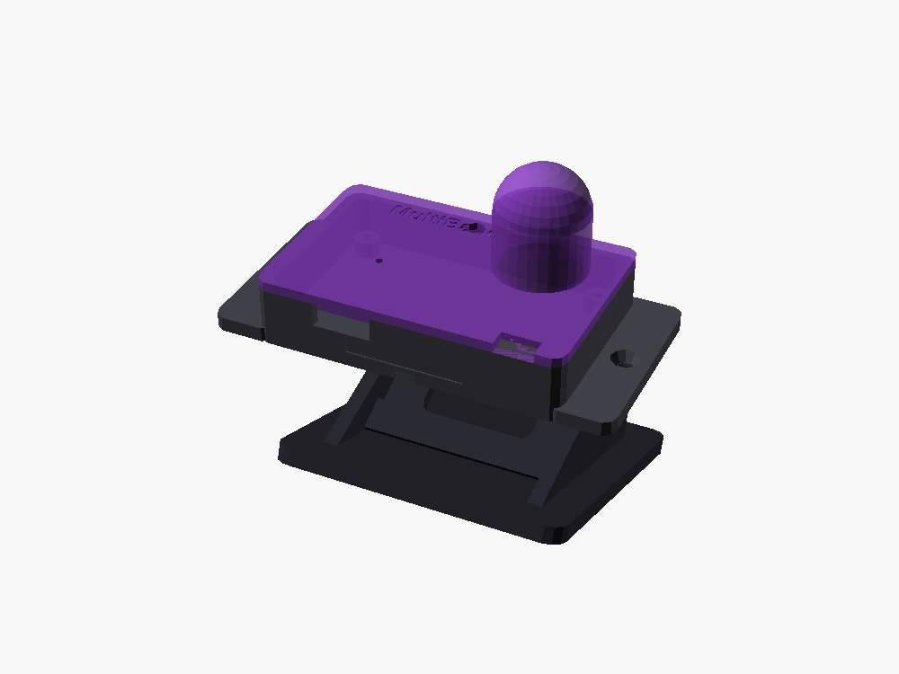
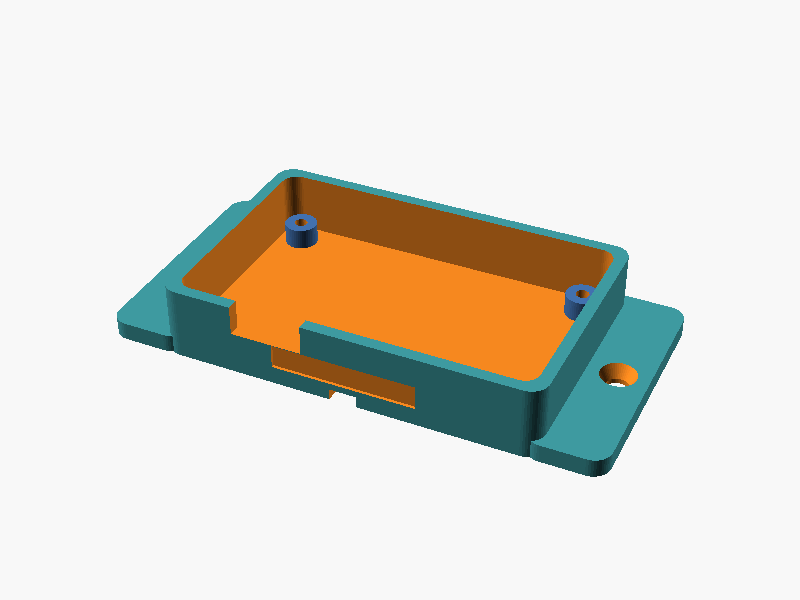

# 🖨️ 3D Printable Multi-Mount Enclosure & Table Stand

A custom, parametric 3D printable enclosure and attachable table stand designed specifically for the **MultiBand 6 ESP32 Beacon**.

Designed to house the **58×36 mm SMT Carrier Board** (or standard ESP32-C3 SuperMini with 16×18 mm inductor), offering versatile mounting options for both **vertical walls** and **horizontal nightstands/desks**.

---

## 3D Assembly Preview

| Full Assembly | Base & Stand |
|:---:|:---:|
|  |  |

---

## 🔩 Multi-Surface Mounting Features

### 1. Vertical Surface Mounting (Walls, Bedframes, Shelves)
* **Screw Mounting Ears:** 2× M3 screw flanges with countersinks for drywall or wood screws.
* **Cable-Tie (Zip-Tie) Channels:** Dual cross-recessed channels (4.5 mm × 2.0 mm) on the underside allow strapping the beacon to bedposts, monitor arms, headboard rails, or pipes.
* **3M Command / VHB Tape Well:** Recessed flat pad ($40\times 24\text{ mm}$) specifically sized for standard 3M Command picture-hanging strips or VHB double-sided foam tape, complete with a pull-tab removal notch.

### 2. Horizontal Surface Mounting (Bedside Tables & Desks)
* **Attachable Table Stand (`table_stand.stl`):** A clip-on cradle with a **$45^\circ$ tilt angle** that aims the 16×18 mm magnetic coil upward and outward toward your watches.
* **Anti-Slip Feet:** 4× 8.0 mm recesses on the bottom of the stand for self-adhesive silicone or rubber bumper pads.

---

## 📁 3D Models & Files

| Part | File | Description |
| :--- | :--- | :--- |
| **Enclosure Base** | [`enclosure_base.stl`](enclosure_base.stl) / [`.scad`](enclosure_base.scad) | Main body with PCB standoffs, M3 screw flanges, zip-tie channels, and USB-C port cutout. |
| **Enclosure Lid** | [`enclosure_lid.stl`](enclosure_lid.stl) / [`.scad`](enclosure_lid.scad) | Snap-fit top cover featuring inductor dome tower, LED breathing light pipe, and manual sync button hole. |
| **Attachable Stand** | [`table_stand.stl`](table_stand.stl) / [`.scad`](table_stand.scad) | $45^\circ$ angled desk cradle with anti-slip foot pads. |
| **Assembly Preview** | [`enclosure_assembly.scad`](enclosure_assembly.scad) | OpenSCAD master file showing all components fitted together. |

---

## 🖨️ Recommended 3D Print Settings

* **Filament:** PLA, PETG, or ABS (PETG recommended for bedside durability).
* **Layer Height:** `0.20 mm` (or `0.16 mm` for smoother dome curvature).
* **Infill:** `15% – 20%` (Gyroid or Grid).
* **Perimeters / Walls:** `3 walls` (1.2 mm wall thickness).
* **Supports:** **None required!** All overhangs, domes, and countersinks are designed within standard $45^\circ$ self-supporting limits.
* **Orientation:**
  * Print `enclosure_base.stl` flat on its bottom.
  * Print `enclosure_lid.stl` flat with the top surface touching the build plate.
  * Print `table_stand.stl` flat on its bottom plate.

---

## 📜 Enclosure License & Commercial Terms

All mechanical CAD sources (`.scad`), exported 3D models (`.stl`), and enclosure documentation in this directory are licensed under the **[CERN Open Hardware Licence Version 2 - Strongly Reciprocal (CERN-OHL-S v2)](../LICENSES/CERN-OHL-S-v2.txt)** (`CERN-OHL-S-2.0`).

* **Open Hardware Permissions:** Anyone may inspect, modify, 3D-print, and distribute enclosures (for personal, educational, or commercial use) in accordance with the CERN-OHL-S v2.
* **Reciprocal Copyleft:** If you convey or distribute manufactured enclosures or modified CAD designs, you must make the Complete Source (`.scad` files and modifications) publicly available under the CERN-OHL-S v2.
* **Commercial License Available:** If your organization wishes to manufacture or sell enclosures or turnkey units under proprietary/closed-source terms without CERN-OHL-S v2 source-disclosure obligations, a separate commercial license is available directly from the copyright holder ([@thomaslr](https://github.com/thomaslr)). See [`LICENSE`](../LICENSE) for full details.
