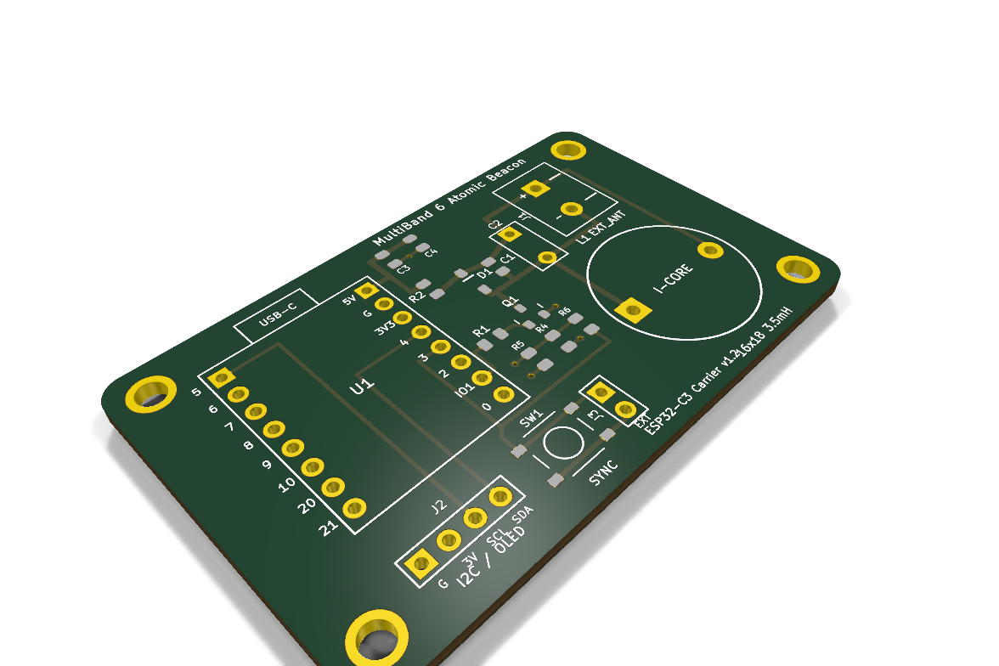
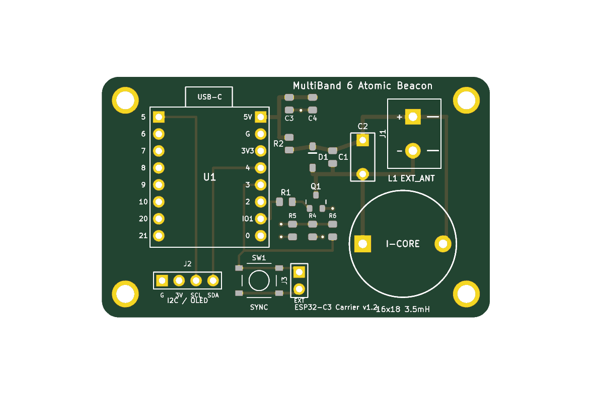

# MultiBand 6 ESP32-C3 Atomic Beacon — SMT Carrier Board (58×36 mm)

A compact, professional 2-layer carrier PCB designed in KiCad for the **MultiBand 6 ESP32 Atomic Clock Beacon**.

This board integrates the high-efficiency RF switching driver, flyback clamp, resonant LC tank, power filtering, and dual antenna connections (onboard 16×18 mm 3.5 mH inductor + external antenna screw terminal block) into a clean **58 mm × 36 mm** footprint with corner M2.5 mounting holes.

All surface-mount components (SMD) have been specifically selected from **[JLCPCB's Basic Component Library](https://jlcpcb.com/)**, meaning they are pre-loaded in JLCPCB's automated pick-and-place feeders and incur **$0.00 setup / reel loading fees** for turnkey SMT assembly.

---

## 3D Renders

| Isometric Perspective | Top Layer Layout |
|:---:|:---:|
|  |  |

---

## Key Hardware Features

1. **Boot-Safe RF Output (`GPIO 1`):**
   * Driven from **GPIO 1** (Pin 15 on ESP32-C3 SuperMini).
   * **100% Strapping Safe:** Unlike GPIO 2 (which is an ESP32-C3 strapping pin that prevents download/flashing if pulled low), GPIO 1 has zero bootloader functions. This allows firmware updates over USB while fully mounted in the circuit without boot lockups.
2. **Through-Hole Capacitor Socket (`C2`):**
   * Standard 5.08 mm (200 mil) pitch through-hole footprint (`P=5.08 mm`, 1.0 mm drill).
   * Allows manual installation or socketing of standard film (polypropylene / CBB) or high-voltage NP0/C0G ceramic capacitors to customize resonant frequency or match non-standard coils.
3. **Screw Terminal Block (`J1`):**
   * Standard 2-pin screw terminal block (`KF301-2P`, 5.08 mm pitch, 1.3 mm drill).
   * Located at the top-right edge, **well clear of the tall 16×18 mm inductor (`L1`)**, with horizontal wire entry facing the board edge for effortless screwdriver access.
   * Allows securely clamping external ferrite bar antennas or loop antennas.
4. **Bedside Manual Sync Pushbutton (`SW1` & `J3`):**
   * Onboard 6×6 mm tactile pushbutton (`SW1`) + 2-pin external header (`J3`) wired to **GPIO 3** with a **10 kΩ pull-up (`R6`)**.
   * One-touch instant manual time broadcast without needing a smartphone or web browser. Pressing during broadcast aborts the transmission immediately. Also configured as a low-power deep-sleep wakeup source.
5. **I2C Expansion Header (`J2`):**
   * Standard 4-pin 2.54 mm header (`GND`, `+3V3`, `SCL/GPIO5`, `SDA/GPIO4`) with dedicated **4.7 kΩ pull-ups (`R4`, `R5`)**.
   * Pinout directly matches popular 0.96" SSD1306 / SH1106 I2C OLED displays and environmental sensors (BME280, SHT31).
6. **Clean SMT Bill of Materials ($0 Setup Cost):**
   * Pre-assembled by JLCPCB with **11 SMD components** (8 unique line items).
   * Every single SMD component, including the **tactile sync button (`SW1`)**, is a verified **JLCPCB Basic Component** ($0.00 feeder loading fee).
7. **Zero Bedside Light Pollution:**
   * No LEDs are placed on the carrier board to prevent unwanted illumination in a dark bedroom.
   * The ESP32-C3 SuperMini's onboard LED (GPIO 8) provides a subtle, calm breathing pulse only while a broadcast is actively running, remaining 100% dark during standby.

---

## Directory Contents

```
pcb/smd/
├── MultiBand6_Beacon.kicad_pro     # KiCad 10 / 9 Project file
├── MultiBand6_Beacon.kicad_sch     # KiCad Schematic file
├── MultiBand6_Beacon.kicad_pcb     # KiCad 2-Layer PCB Layout file (58x36 mm)
├── MultiBand6_Beacon_Gerbers.zip   # Ready-to-order Gerbers + Drill archive for JLCPCB
├── MultiBand6_Beacon-drc.rpt       # Clean KiCad DRC Report (0 errors, 0 warnings, 0 unconnected)
├── make_pcb.py                     # Automated Python layout & manufacturing generator
├── MultiBand6_Beacon_Gerbers/      # Raw JLCPCB-formatted Gerbers & Drills
│   ├── MultiBand6_Beacon-F_Cu.gtl
│   ├── MultiBand6_Beacon-B_Cu.gbl
│   ├── MultiBand6_Beacon-F_Mask.gts
│   ├── MultiBand6_Beacon-B_Mask.gbs
│   ├── MultiBand6_Beacon-F_Silkscreen.gto
│   ├── MultiBand6_Beacon-B_Silkscreen.gbo
│   ├── MultiBand6_Beacon-F_Paste.gtp
│   ├── MultiBand6_Beacon-B_Paste.gbp
│   ├── MultiBand6_Beacon-Edge_Cuts.gm1
│   ├── MultiBand6_Beacon-PTH.drl   # Plated Through-Hole Drill file
│   ├── MultiBand6_Beacon-NPTH.drl  # Non-Plated Through-Hole Drill file
│   └── MultiBand6_Beacon-job.gbrjob
├── bom.csv                         # SMT Bill of Materials (with LCSC Basic Part #s)
└── positions.csv                   # Centroid Pick-and-Place (CPL) file (calibrated coordinates & rotations)
```

> [!NOTE]
> **Looking for a 100% hand-solderable through-hole DIY design?** Check out [`pcb/hole-through/`](../hole-through/), which features an enlarged $70\text{ mm} \times 46\text{ mm}$ layout accommodating standard axial resistors, DO-41 diode, TO-92 transistor, and M3 mounting holes with zero surface mount components.

---

## Bill of Materials (SMT Assembly via JLCPCB)

All 11 SMD parts below are **JLCPCB Basic Components** ($0.00 part-loading fee):

| Designator | Value | Package | Description | LCSC Part # | JLCPCB Type |
| :--- | :--- | :--- | :--- | :--- | :--- |
| **SW1** | TS-1187A-B-A-B | SMD 5.1×5.1mm | Momentary Manual Sync Tactile Switch (GPIO 3) | `C318884` | **Basic** |
| **Q1** | MMBT2222A | SOT-23 | 600mA 40V NPN RF Switch Transistor | `C8512` | **Basic** |
| **D1** | 1N5819HW (B5819W) | SOD-123 | 1A 40V Schottky Inductive Clamp Diode | `C8598` | **Basic** |
| **C1** | 1.5nF (1500pF) | 0805 | 50V X7R Ceramic LC Tank Resonator | `C1717` | **Basic** |
| **C3, C4** | 10µF | 0805 | 25V X5R Ceramic Power Supply Decoupling | `C15850` | **Basic** |
| **R1** | 1kΩ | 0805 | 1% 1/8W Base Drive Resistor | `C17513` | **Basic** |
| **R2** | 220Ω | 0805 | 1% 1/8W Tank Current Limiter / Q Damping | `C17560` | **Basic** |
| **R4, R5** | 4.7kΩ | 0805 | 1% 1/8W I2C Bus Pull-Ups (SDA/SCL) | `C17673` | **Basic** |
| **R6** | 10kΩ | 0805 | 1% 1/8W Pushbutton Pull-Up (GPIO 3) | `C17414` | **Basic** |

### Hand-Soldered Through-Hole Components

| Designator | Description | Recommended Part | Sourcing |
| :--- | :--- | :--- | :--- |
| **U1** | ESP32-C3 SuperMini Socket | 2× 1×8 Female Header 2.54 mm | Standard headers |
| **L1** | 16×18 mm 3.5 mH Drum Core Inductor | Open magnetic circuit radial inductor | AliExpress / Taobao / LCSC |
| **J1** | External Antenna Terminal Block | 2-pin 5.08 mm pitch screw terminal (KF301-2P) | Standard terminal block |
| **J2** | I2C Display Header | 1×4 Pin Header (Male or Female) 2.54 mm | Standard 2.54 mm header |
| **J3** | External Sync Button Header | 1×2 Pin Header 2.54 mm | Standard 2.54 mm header |
| **C2** | Auxiliary Tuning Capacitor Socket | Standard 5.08 mm pitch through-hole capacitor socket | Optional for tuning |

---

## How to Order from JLCPCB

1. **PCB Fabrication:**
   * Go to [JLCPCB.com](https://jlcpcb.com/) and click **Order Now**.
   * Upload `MultiBand6_Beacon_Gerbers.zip` (located in this folder).
   * Dimensions: **58 mm × 36 mm** (auto-detected).
   * Layers: **2 Layers**, Thickness: **1.6 mm**, Surface Finish: **HASL (with lead)** or **LeadFree HASL**.
2. **SMT Assembly:**
   * Turn ON **PCB Assembly** (Assemble Top Side).
   * Upload `bom.csv` as the **BOM**.
   * Upload `positions.csv` as the **CPL (Pick-and-Place)** file.
   * All 11 SMD parts are automatically assigned as **Basic Parts** ($0.00 setup fees).
   * Confirm the 3D preview alignment and place your order!

---

## 📜 Hardware License

Licensed under the **[CERN Open Hardware Licence Version 2 - Strongly Reciprocal (CERN-OHL-S v2)](../../LICENSES/CERN-OHL-S-v2.txt)** (`CERN-OHL-S-2.0`). **Commercial License Available** for proprietary/closed-source manufacturing — see [`LICENSE`](../../LICENSE).
